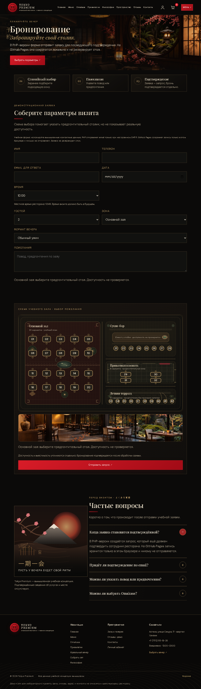
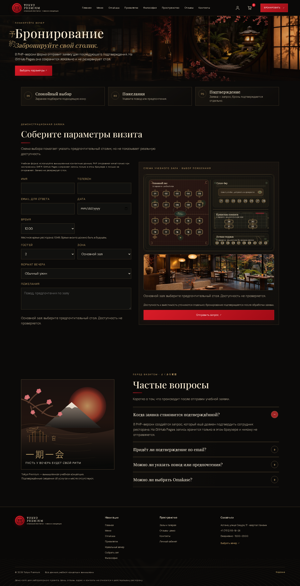

# Booking vertical rhythm — 2026-11-23

Focused comparison against [approved reference 07](../../../design-references/07-reservation.png).

- Public page: `https://altento.github.io/tokyo-premium/booking.html?release=7f82250`.
- Desktop hero height: 280 px at 1024 px and 312 px at 1440 px, down from 332 px and 365 px before the fix.
- Mobile hero remains 390 px at a 390 px viewport.
- The timezone hint now spans the booking form width instead of stretching only the time field.
- At 1024 px, the form and floorplan use separate full-width rows (881 px each), making all four zones and table labels easier to read. At 1440 px, the two-column composition remains intact (529 px form / 673 px map).
- The floorplan and room photo loaded; the table remains a preference and does not imply live availability.
- Browser checks at 390, 1024 and 1440 px returned HTTP 200, with no page overflow, clipped title, or JavaScript page errors. At 1024 px the map stacked below the form; at 1440 px they remained side-by-side.
- Images were forced to load before full-page capture. These are real public Pages screenshots; this focused adjustment does not claim pixel-perfect parity with the complete reference.

